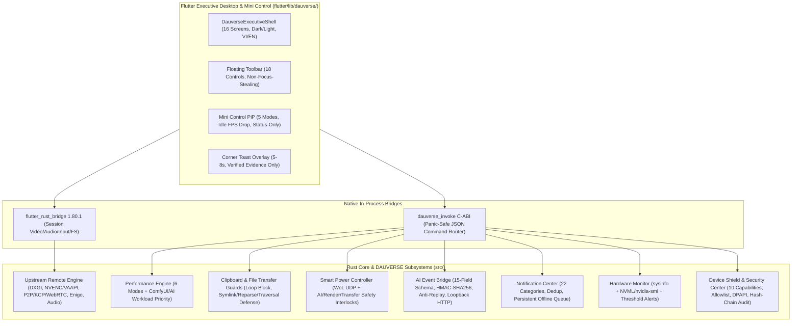

# DAUVERSE REMOTE DESKTOP V1.0 — ARCHITECTURE & SECURITY SPECIFICATION

## 1. System Architecture Overview

`DAUVERSE REMOTE DESKTOP V1.0` combines the battle-tested **RustDesk v1.5.3 Remote Engine** with modular, additive **DAUVERSE AI Workstation Subsystems** in Rust (`src/dauverse/`) and an **Executive SaaS Flutter Desktop UI** (`flutter/lib/dauverse/`).

---

## 2. Key Technical Decisions

1. **Zero Protocol Reinvention:** Transport encryption (`Curve25519` + `XSalsa20-Poly1305` / NaCl via `sodiumoxide`), P2P NAT traversal, KCP/WebRTC streaming, and hardware codec negotiation (`NVENC`, `H.264`, `H.265`) inherit directly from upstream RustDesk without weakening cryptographic primitives.
2. **Minimally Invasive Additive Layering:** All DAUVERSE backend capabilities reside in `src/dauverse/*` with a single `pub mod dauverse;` export in `src/lib.rs`, preserving 100% upstream regression safety when standard RustDesk paths execute.
3. **Panic-Safe Cross-Platform C-ABI (`dauverse_invoke`):** Exposes DAUVERSE telemetry, security controls, AI Event Bridge, and Smart Power across Windows (`librustdesk.dll`), Linux (`librustdesk.so`), macOS (`librustdesk.dylib`), and future iOS/Android targets without fragile macro codegen coupling.

---

## 3. Device Shield Security Model (Section 24)

- **Mutual Authentication & Channel Binding:** Active sessions bind `(session_id, device_id, channel_binding_hash)`; any peer key mismatch or channel-binding drift immediately revokes the session (`SECURITY_DENY_SESSION_HIJACK_OR_MITM_DETECTED`).
- **Trusted Device Allowlist & Instant Revocation:** Unattended access denies unknown peers when `allowlist_enforced = true` and provides 1-click emergency revocation (`revoke_all_access`) terminating unattended flags and sessions immediately.
- **10 Granular Per-Session Capabilities:** `RemoteControl`, `ViewOnly`, `Clipboard`, `FileTransfer`, `Audio`, `PowerControl`, `HardwareMonitoring`, `AiNotification`, `AiStatus`, `Recording` (default deny on `Recording`, `PowerControl`, `RemoteControl` for untrusted profiles).
- **Brute-Force & Replay Defense:** Sliding-window failed-attempt tracker locks out abusive peers after 5 failures within 60 seconds; nonce caches block replay on both session auth and AI Event Bridge envelopes.
- **Credential Storage (`DPAPI`):** On Windows (`#[cfg(windows)]`), secrets are sealed with `CryptProtectData` (`CRYPTPROTECT_UI_FORBIDDEN`) via `winapi::um::dpapi`. On Unix, secrets use `0600` machine-bound Encrypt-then-MAC (`DVSEAL01`). Plaintext credential storage is prohibited.
- **File System & Clipboard Hardening:** `validate_and_resolve_destination` rejects `..`, absolute/UNC paths, Windows reserved device names (`CON`, `NUL`, `COM1`..`9`, `LPT1`..`9`), symlinks, and NTFS junctions/reparse points (`FILE_ATTRIBUTE_REPARSE_POINT`). Received files and clipboard items are strictly inert and never auto-executed.
- **Tamper-Evident Audit Log & Zero Telemetry:** Every security-sensitive event is recorded in a SHA-256 hash chain (`prev_hash -> entry_hash`) with automatic secret redaction (`redact_sensitive`). Outbound telemetry is disabled by default.
